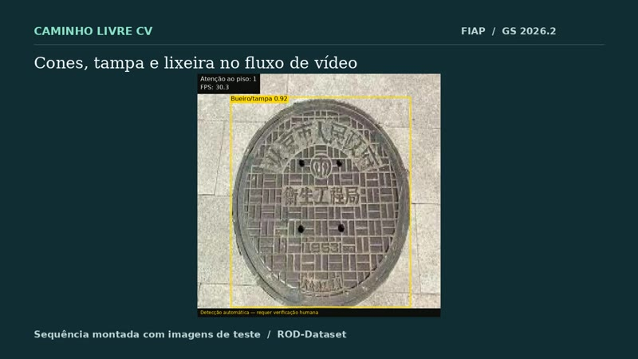
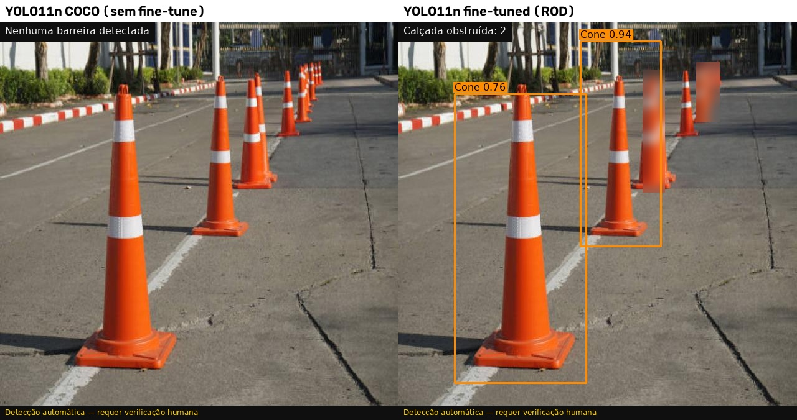

# Caminho Livre CV

Módulo de visão computacional do Caminho Livre, mapa colaborativo de barreiras de acessibilidade. O detector sinaliza objetos urbanos em quadros de webcam, vídeo ou imagens para triagem humana.

**Global Solution FIAP 2026.2 · Engenharia de Software 4ES · Applied Computer Vision**
Arnaldo Viana e Paulo Rodrigues

## Entrega

- [Relatório técnico em PDF](docs/Caminho_Livre_CV_Relatorio.pdf)
- [Vídeo demonstrativo](docs/Caminho_Livre_CV_Demonstracao.mp4)
- [Pesos treinados](models/best.pt) · [Relatório em Markdown](docs/relatorio.md)

[](docs/Caminho_Livre_CV_Demonstracao.mp4)

| Integrante | RM |
|---|---:|
| Guilherme Rocha Bianchini | 97974 |
| Nikolas Rodrigues Moura dos Santos | 551566 |
| Rodrigo Brasileiro | 98952 |
| Thiago Jardim de Oliveira | 551624 |

## Executar a demonstração

Clone ou descompacte o projeto e execute a partir da raiz, com Python 3.12.

```bash
python -m venv .venv
# Linux/macOS: source .venv/bin/activate
# Windows PowerShell: .venv\Scripts\Activate.ps1
python -m pip install -r requirements.txt
python -m pip install -e .
python -m pytest
```

Os pesos entregues ficam em `models/best.pt`. Se necessário, baixe-os no link acima. Use a mesma resolução e confiança da demonstração.

```bash
# Webcam
python -m caminho_livre_cv.detect --source 0 --imgsz 320 --conf 0.25

# Vídeo e gravação da saída sem abrir janela
python -m caminho_livre_cv.detect --source trecho.mp4 --imgsz 320 --conf 0.25 --save trecho_anotado.mp4 --no-show

# Imagem individual ou pasta de imagens
python -m caminho_livre_cv.detect --source imagens/ --imgsz 320 --conf 0.25 --save saida/ --no-show
```

Use `--weights` para trocar o checkpoint. Com a janela aberta, `q` ou `Esc` encerra. O programa desfoca pessoas detectadas por padrão, e a contagem descreve somente o quadro em exibição. O clipe da demonstração é de [Eudes cs, no Pexels](https://www.pexels.com/video/a-traffic-cone-with-a-yellow-and-black-tape-on-it-27660147/).

As categorias do painel estão em [configs/barriers.yaml](configs/barriers.yaml). O sistema distingue possíveis obstruções, veículos para revisão, escadas ou degraus, elementos de piso e travessias para contexto.

## Reproduzir o treino

O checkpoint entregue foi ajustado a partir dos pesos COCO do YOLO11n, por 15 épocas, em CPU, com entrada de 320 px, lote 16, AdamW, taxa inicial de 0,002 e semente 42. A seleção determinística usa 600 imagens de treino, 125 de validação e 150 de teste, nas divisões originais do ROD-Dataset. As variantes da mesma origem identificadas pelo manifesto do dataset são mantidas em uma só divisão.

```bash
python -m scripts.prepare_sample
python -m scripts.train_sample
python scripts/benchmark_fps.py --weights runs/amostra-rod/best.pt --images data/rod-sample/test/images --imgsz 320 --n 140 --warmup 10
```

O script de treino grava `runs/amostra-rod/best.pt` e `runs/amostra-rod/test_metrics.json`. Para reproduzir o exemplo de comparação, use os IDs em [exemplos](docs/assets/examples.json) e `python scripts/compare_baseline.py --images <arquivos> --imgsz 320 --conf 0.25`.

O [notebook de Colab](notebooks/train_colab.ipynb) mantém disponível o protocolo de treino com o conjunto completo, 50 épocas e entrada de 640 px em GPU. As métricas de entrega vêm do experimento de 875 imagens descrito acima.

## Resultados

| Métrica | Resultado |
|---|---:|
| Imagens no teste reservado | 150 |
| mAP50 | 47,55% |
| mAP50–95 | 32,21% |
| Precisão macro | 56,52% |
| Revocação macro | 45,71% |
| Predição em CPU | 36,9 quadros/s |
| Latência média / P95 | 27,1 / 31,2 ms |

O benchmark usa 140 imagens após 10 de aquecimento e mede pré-processamento, inferência e pós-processamento, com leitura de disco e painel fora da medição. Evidências disponíveis em [métricas por classe](docs/assets/test_metrics.json), [curva precisão-revocação](docs/assets/BoxPR_curve.png), [matriz de confusão](docs/assets/confusion_matrix_normalized.png), [histórico de treino](docs/assets/results.csv), [benchmark](docs/assets/fps.json) e [seleção de imagens](docs/assets/split_manifest.csv).



O conjunto cobre 25 classes e a qualidade varia por classe. O projeto usa uma amostra fora do domínio local, o que limita a generalização para outros tipos de calçada. Veículos detectados requerem confirmação da posição em relação à passagem. Rampas e largura livre estão fora das classes treinadas. O desfoque é uma mitigação dependente da detecção de pessoas.

## Dados e licenças

- [ROD-Dataset](https://huggingface.co/datasets/Abtinzandi/Obstacle-Detection-Dataset-YOLO), revisão `103b38ccb6c80be269e5c7288e63b828d6f54e0b`. O agregado é MIT e os conjuntos do Roboflow mantêm suas licenças de origem. [Artigo de Zandi et al.](https://arxiv.org/abs/2611.00681)
- Código e pesos do detector sob [AGPL-3.0](LICENSE), compatível com a licença do [Ultralytics YOLO11](https://docs.ultralytics.com/models/yolo11/).
- O trecho de Eudes cs foi editado com o painel e tem atribuição na demonstração. [Licença Pexels](https://www.pexels.com/license/)
