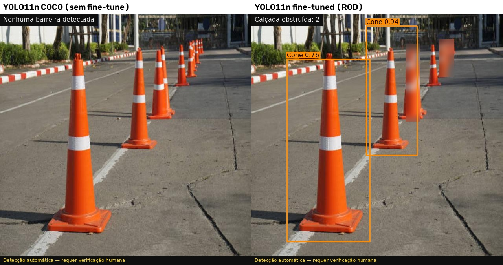
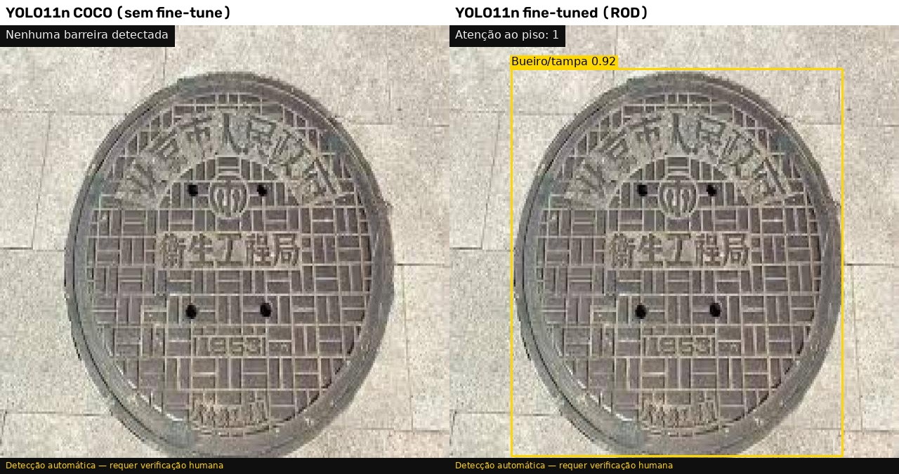

# Caminho Livre CV

Global Solution FIAP 2026.2 • Engenharia de Software 4º ano • Applied Computer Vision
Arnaldo Viana e Paulo Rodrigues

## Ficha técnica do MVP

**Produto.** Caminho Livre, mapa colaborativo de barreiras de acessibilidade.

**Cidadão e território.** Pedestres com deficiência ou mobilidade reduzida, idosos e cuidadores no entorno da FIAP Paulista, São Paulo (SP). O piloto cobre cerca de 1,2 × 1,5 km.

**Problema.** Relatos sobre barreiras em calçadas e travessias ficam dispersos, e o cidadão tem dificuldade para acompanhar sua resolução.

**Proposta de valor.** O cidadão registra uma barreira no mapa e acompanha seu status. A equipe gestora recebe uma fila de relatos para revisar, priorizar e encerrar.

**Arquitetura e componentes.** O mapa web usa Leaflet e OpenStreetMap. A API FastAPI usa SQLite persistente no Azure App Service. O painel por quadra recebe dados agregados do componente de Big Data. O detector desta disciplina roda localmente e gera anotações para revisão humana. O registro de uma barreira no mapa é manual.

**Fontes de dados.** OpenStreetMap e relatos enviados pelo MVP, incluindo relatos sintéticos identificados como demonstração. O detector usa uma amostra do ROD-Dataset.

**Modelo de IA.** YOLO11n ajustado para 25 classes de objetos urbanos. A identificação da barreira e de sua posição na passagem depende de revisão humana.

**Links.** [MVP público](https://caminholivre-gs.azurewebsites.net/) · [Repositório principal](https://github.com/santos-nikolas/caminho-livre) · [Repositório de visão computacional](https://github.com/Breqsz/caminho-livre-cv)

**Indicadores planejados.** Relatos recebidos e revisados, tempo até a primeira revisão, relatos resolvidos com confirmação e taxa de resolução. A melhoria física requer verificação em campo.

**ODS.** ODS 10, redução das desigualdades. ODS 11, metas 11.2 e 11.7, acesso a transporte e espaços públicos acessíveis.

## Integrantes

- Guilherme Rocha Bianchini • RM 97974
- Nikolas Rodrigues Moura dos Santos • RM 551566
- Rodrigo Brasileiro • RM 98952
- Thiago Jardim de Oliveira • RM 551624

## Resumo

Calçadas com obstáculos podem dificultar deslocamentos, sobretudo para pessoas com mobilidade reduzida. O Caminho Livre CV é o módulo de visão computacional da solução CitizenTech Caminho Livre. O módulo processa quadros de webcam, vídeo ou imagens para identificar objetos urbanos que merecem revisão em um fluxo de mapeamento colaborativo. O experimento ajustou um detector YOLO11n inicializado com pesos COCO usando uma amostra reproduzível de 875 imagens do ROD-Dataset. A seleção preservou as divisões originais, com 600 imagens para treino, 125 para validação e 150 para teste, cobrindo as 25 classes do conjunto. O checkpoint foi selecionado pela validação e medido no teste reservado. Em operação, o OpenCV lê a fonte e a aplicação traduz as detecções para rótulos em português, desenha caixas com índices de confiança e indica a taxa de processamento em vídeo. A aplicação desfoca as regiões classificadas como pessoa por padrão. A avaliação registra precisão, revocação, mAP50, mAP50–95 e velocidade em CPU. A demonstração usa vídeo urbano real para mostrar a leitura de quadros em sequência e exemplos anotados do conjunto de teste para ilustrar outras classes. O protótipo sinaliza indícios como cones, lixeiras, degraus e tampas no piso. Um carro identificado na imagem exige análise adicional para verificar se bloqueia a passagem. O resultado pode apoiar uma triagem comunitária antes de registrar barreiras no mapa. A amostra e a mudança de domínio limitam a generalização. Uma validação em calçadas locais, com variedade de iluminação e perspectiva, é necessária para avaliar a utilidade em condições de campo.

## Introdução

O Caminho Livre propõe um mapa colaborativo de barreiras de acessibilidade. O módulo de visão ajuda a localizar objetos que merecem revisão durante a observação da via. Uma caixa que identifica um cone, uma escada ou uma lixeira oferece contexto para que a equipe decida se a passagem está comprometida. A unidade de análise é o quadro de vídeo, e a contagem descreve somente o quadro exibido.

## Objetivo

Desenvolver e avaliar um detector customizado de objetos urbanos que sinalize potenciais barreiras de acessibilidade em calçadas. O protótipo deve processar quadros de vídeo ou webcam, exibir caixas, classes e contagens em português, proteger pessoas detectadas com desfoque e fornecer evidências reproduzíveis para a triagem humana no projeto Caminho Livre.

## Ferramentas

- **YOLO11n + PyTorch.** O detector de estágio único produz caixas, classes e confianças na mesma inferência. A variante nano favorece a execução em CPU. O PyTorch executa o ajuste e a inferência.
- **Ultralytics 8.3.253.** A biblioteca carrega o checkpoint de COCO, treina o detector e calcula métricas de detecção em validação e teste.
- **OpenCV + Pillow.** O OpenCV decodifica webcam e vídeo, aplica desfoque gaussiano e grava a saída. O Pillow desenha texto em português e o painel sobre os quadros.
- **Python + YAML.** Os scripts reproduzem a amostra e o treino. O arquivo YAML de categorias separa a apresentação da saída do modelo.

## Metodologia

1. **Selecionar dados.** Fixar a revisão do ROD-Dataset e amostrar 600 imagens de treino, 125 de validação e 150 de teste, com semente 42. A seleção prioriza as classes menos frequentes e mantém as divisões de origem.
2. **Controlar sobreposição.** Agrupar variantes pelo nome original antes do sufixo de exportação do Roboflow. Excluir da seleção de validação e teste as origens já presentes em uma divisão anterior. Conferir os hashes das imagens entre divisões.
3. **Preparar a detecção.** Gerar data_cl.yaml com os caminhos e as 25 classes. Corrigir a grafia da classe 20 sem modificar seu índice. O carregador do Ultralytics converte polígonos do conjunto em caixas para a tarefa de detecção.
4. **Ajustar o detector.** Iniciar o YOLO11n com pesos COCO e ajustar os pesos treináveis do modelo durante 15 épocas em CPU, com imagens de 320 px, lote 16 e AdamW com taxa inicial de 0,002.
5. **Selecionar e avaliar.** Selecionar best.pt pela validação. Rodar a avaliação no split de teste e medir o tempo de predição em CPU após aquecimento.
6. **Demonstrar a aplicação.** Ler os quadros com OpenCV, inferir as caixas, desfocar as pessoas detectadas, desenhar o painel em português e gravar o vídeo anotado. A confiança configurada na demonstração em vídeo é informada na gravação.

## Resultados

mAP50 **47,55%** | mAP50–95 **32,21%** | Precisão **56,52%** | Revocação **45,71%**

O teste reservado usou 150 imagens e entrada de 320 px. A predição em CPU alcançou 36,9 quadros/s no benchmark de 140 imagens. A média foi de 27,1 ms por predição e o P95 foi de 31,2 ms. O benchmark inclui pré e pós-processamento e exclui leitura de arquivo e desenho do painel.

IMG_20548.jpg • Cone. A imagem do teste é a mesma nos dois lados. O YOLO11n ajustado sinalizou cones com limiar de confiança de 0,25.

IMG_20496.jpg • Tampa no piso. A imagem do teste é a mesma nos dois lados. O YOLO11n ajustado sinalizou uma tampa com limiar de confiança de 0,25.

## Conclusão

A primeira versão permite selecionar objetos para triagem visual e registra saída reproduzível por imagem ou vídeo. A distribuição de teste representa uma amostra do ROD-Dataset. Na cena externa, o detector acompanhou carros em parte do trecho e deixou o cone em primeiro plano sem marcação nos quadros examinados. A transferência para calçadas brasileiras requer validação local. O detector depende de visibilidade, escala e iluminação. Um veículo na imagem pode estar na rua, e rampas e largura livre de passagem estão fora das classes treinadas. O desfoque automático depende da detecção de pessoas. A decisão sobre acessibilidade continua a exigir análise humana.

## Referências

- [Dados ROD-Dataset](https://huggingface.co/datasets/Abtinzandi/Obstacle-Detection-Dataset-YOLO)
- [Trabalho de Zandi et al.](https://arxiv.org/abs/2611.00681)
- [Documentação YOLO11](https://docs.ultralytics.com/models/yolo11/)
- [Trecho de vídeo de Eudes cs, Pexels](https://www.pexels.com/video/a-traffic-cone-with-a-yellow-and-black-tape-on-it-27660147/)
- [Repositório](https://github.com/Breqsz/caminho-livre-cv)
- [Vídeo demonstrativo](https://github.com/Breqsz/caminho-livre-cv/blob/main/docs/Caminho_Livre_CV_Demonstracao.mp4)
